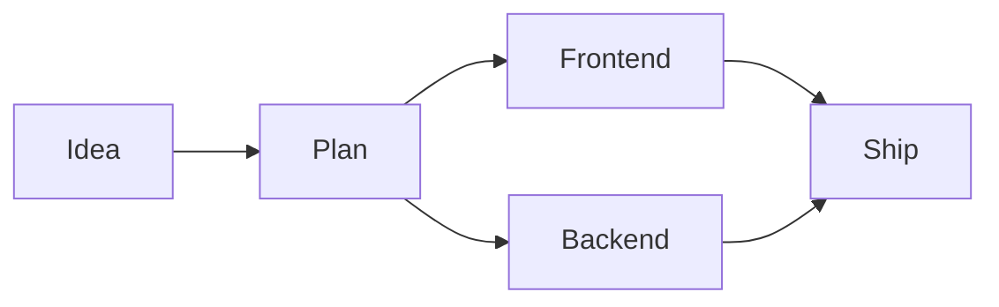

# vue-mermaid-steps

A Vue 3 component for progressively revealing Mermaid diagrams. Nodes and edges
in completed steps stay fully visible; future steps are dimmed.

Built on [vue-mermaid-string](https://www.npmjs.com/package/vue-mermaid-string).
Requires Vue 3.5 or later and an ESM-capable Vue application.

[Live playground](https://murznn.github.io/vue-mermaid-steps/) |
[npm package](https://www.npmjs.com/package/vue-mermaid-steps) |
[GitHub repository](https://github.com/MurzNN/vue-mermaid-steps)

## Installation

Install [vue-mermaid-steps from npm](https://www.npmjs.com/package/vue-mermaid-steps):

```sh
pnpm add vue-mermaid-steps
```

## Usage

```vue
<script setup lang="ts">
import { ref } from 'vue'
import VueMermaidSteps from 'vue-mermaid-steps'

const steps = 3
const currentStep = ref(0)
const diagram = ref(`flowchart LR
    Start step1E@--> Plan:::step1
    Plan step2E@--> Build:::step2
    Build step3E@--> Ship:::step3
    classDef step1 fill:#f99
    classDef step2 fill:#9f9
    classDef step3 fill:#99f
`)
</script>

<template>
  <button @click="currentStep = Math.max(0, currentStep - 1)">Previous</button>
  <button @click="currentStep = Math.min(steps, currentStep + 1)">Next</button>
  <VueMermaidSteps
    :diagram="diagram"
    :steps="steps"
    :current-step="currentStep"
  />
</template>
```

Both default and named imports are available:

```ts
import { VueMermaidSteps } from 'vue-mermaid-steps'
```

The same component works in Slidev: import it in a slide's `<script setup>` and
bind `current-step` to reactive state (or Slidev's `$clicks`).

## Props

All props are reactive. `diagram` and `steps` are required; all other props are
optional.

| Prop | Type | Meaning |
| --- | --- | --- |
| `diagram` | `string` | Mermaid source code. |
| `steps` | `number` | Non-negative integer number of step classes to generate. |
| `currentStep` | `number` | Optional integer number of steps to reveal, normally from `0` to `steps`. Defaults to `0` (all steps dimmed). |
| `edgesPerStep` | `number` | Non-negative safe integer number of edge IDs to map per step, including the base ID. Defaults to `8`. |
| `inactiveOpacity` | `number` | Opacity of future steps, from `0` (transparent) to `1` (fully visible). Defaults to `0.2`. Invalid values raise a `RangeError`. |
| `currentStepStyle` | `string` | Mermaid style declarations for nodes in exactly the current step. Defaults to `''`. |
| `dimmedStepsStyle` | `string` | Mermaid style declarations for nodes in future (dimmed) steps. Defaults to `''`. |
| `currentStepEdgeStyle` | `string` | Mermaid style declarations for edges in exactly the current step. Defaults to `''`. |
| `dimmedStepsEdgeStyle` | `string` | Mermaid style declarations for edges in future (dimmed) steps. Defaults to `''`. |
| `currentStepCss` | `string` | CSS declarations for rendered current-step node shapes. Defaults to `''`. |
| `currentStepEdgeCss` | `string` | CSS declarations for rendered current-step edge paths. Defaults to `''`. |

### Step classes

- Assign nodes to `step1`, `step2`, etc. using `:::step1` or `class`.
- Name edges `step1E`, `step2E`, etc. using Mermaid's `id@-->` syntax.
  The component automatically maps these IDs to the corresponding edge class.
- Elements in steps up to `currentStep` have opacity `1`.
- Later steps use `inactiveOpacity` (default `0.2`); completed steps stay at `1`.
- Custom style strings are appended after the default opacity declaration and
  can override it. Current-step style props do not apply to completed steps.
- At step `0`, all numbered steps are dimmed. At `steps`, all are visible.
- Elements without step classes are unaffected.
- `steps: 0` passes the diagram through unchanged.
- Values of `currentStep` below `0` dim every step; values above `steps` reveal
  every step. They do not generate additional step classes.

### Edge naming convention

By default, each step maps 8 unique edge IDs: the base `stepNE` plus `stepNEa`
through `stepNEg`, where `N` is the step number. For step 1 these are:

```text
step1E, step1Ea, step1Eb, step1Ec, step1Ed, step1Ee, step1Ef, step1Eg
```

Adjust dimming independently of the current step:

```vue
<VueMermaidSteps :diagram="diagram" :steps="3" :inactive-opacity="0.4" />
```

Customize the current and dimmed steps using Mermaid's comma-separated
`classDef` style syntax (not CSS declaration blocks):

```vue
<VueMermaidSteps
  :diagram="diagram"
  :steps="3"
  :current-step="currentStep"
  current-step-style="fill:#ffe08a,stroke:#d97706,stroke-width:3px"
  dimmed-steps-style="opacity:0.1"
/>
```

Both props affect only the corresponding node classes; edges are unchanged. Completed steps
receive neither custom style string. Changing or clearing these props updates
the diagram reactively; an empty string retains the default opacity behavior.
At step `0`, only `dimmedStepsStyle` applies; above `steps`, neither applies.

Style nodes and edges independently with the specific props:

```vue
<VueMermaidSteps
  :diagram="diagram"
  :steps="3"
  :current-step="currentStep"
  current-step-style="fill:#ffe08a,stroke:#d97706"
  current-step-edge-style="stroke:#d97706,stroke-width:3px"
  dimmed-steps-style="opacity:0.1"
  dimmed-steps-edge-style="opacity:0.3,stroke:#999"
/>
```

Node and edge styles are independent and appended after default opacity.
Later declarations override earlier ones for the same property while retaining
other existing Mermaid class styles. Empty strings add no declarations, leaving
default opacity behavior intact. All four props follow the same current/future
step rules and update reactively. There is no shared node-and-edge style prop.

For native CSS, use semicolon-separated declarations (no selectors or braces):

```vue
<VueMermaidSteps
  :diagram="diagram"
  :steps="3"
  :current-step="currentStep"
  current-step-css="filter: drop-shadow(0 0 4px gold);"
  current-step-edge-css="stroke: gold; stroke-width: 4px;"
/>
```

CSS is applied after rendering, only to the current step's SVG node shapes and
edge paths, not node labels or arrowhead markers. Declarations are applied inline
with `!important` to override Mermaid styling. Clearing a CSS prop restores the
original styles; moving steps or rerendering reapplies CSS to the new current
step only. Edge CSS supports automatic IDs and manual `class customId stepNE`
mappings, including when `edgesPerStep` is `0`. Invalid CSS declarations are
ignored by the browser's CSS parser. Treat CSS strings as trusted input, just
like diagram content.

Mermaid edge IDs must be unique within the diagram. Use a different suffix for
each edge in the same step; all configured IDs are automatically assigned to the shared
`stepNE` class. Only use the IDs you need; unused mappings add no nodes or edges.
The IDs are case-sensitive, with an uppercase `E` and lowercase suffixes.

Pass `:edges-per-step="16"` to map the base ID plus `a` through `o`, or use a
larger count as needed. Suffixes continue `a` ... `z`, `aa`, `ab`, ...; for
example, `28` includes `stepNEaa`. The count includes the unsuffixed base ID.
Changing this prop regenerates the mappings. `0` disables automatic edge
mappings while retaining node and edge class opacity definitions. Invalid
counts (negative, fractional, or non-finite) raise a `RangeError`.

```vue
<VueMermaidSteps :diagram="diagram" :steps="3" :edges-per-step="16" />
```

For example, two branches can reveal together without manual `class` mappings:



The component appends edge `class` mappings and `classDef` opacity declarations
for every configured step. IDs beyond `edgesPerStep` are not automatically mapped.
Existing custom edge IDs and manual `class customId stepNE` mappings still work.

Existing colors and other class styles are preserved unless overridden by the
custom style props; step opacity defaults to the component's generated value.
Supply a complete, valid Mermaid diagram, ending outside any
subgraph, comment or directive. Classes beyond the configured `steps` are not
modified.

### Renderer options and events

Attributes and listeners are forwarded to `vue-mermaid-string`, including
`class`, `style`, `options`, `@rendered`, `@node-click`, and `@parse-error`.
For example:

```vue
<VueMermaidSteps
  :diagram="diagram"
  :steps="3"
  :current-step="currentStep"
  :options="{ theme: 'dark' }"
  @parse-error="handleParseError"
/>
```

Mermaid's default error display is retained. Handle `parse-error` for custom
error reporting. Only render diagram content from sources you trust; this
component does not add sanitization beyond the underlying renderer.

## Development

Run commands from this directory. Node.js 22.12+ and pnpm are required; no Slidev
installation or files from a parent repository are needed.

```sh
pnpm install --frozen-lockfile
pnpm run typecheck
pnpm test
pnpm run build
```

- `pnpm run test:watch` runs tests in watch mode.
- `pnpm run build` creates an ESM library and TypeScript declarations in `dist/`.
- Vue and `vue-mermaid-string` are externalized from the build.
- Tests stub the Mermaid renderer to verify source generation, prop reactivity,
  attribute forwarding, and events without coupling to SVG layout.
- Playground tests cover editing, step controls, validation, and error recovery.

## GitHub build

[The build workflow](./.github/workflows/build.yml) runs on pushes, pull requests,
and manual dispatch. It installs from the lockfile, checks types, runs tests,
builds, and uploads an npm tarball as an artifact. It does not publish to npm
and requires no registry credentials.

## Live playground and GitHub Pages

The [playground](./playground/App.vue) includes an editable Mermaid source,
step-count input, current-step and inactive-opacity sliders, previous/next and hide/show controls,
four Mermaid style inputs and two current-step CSS inputs below the chart,
resettable example, and explicit
validation/rendering errors. Source changes are applied with **Apply diagram**;
step, opacity, and style changes update the preview immediately. Style inputs
accept comma-separated Mermaid declarations and are reflected in the usage
example. Clear them to restore default styling, or use **Reset example** to
reset all controls.

```sh
pnpm run dev
pnpm run build:playground
pnpm run preview
```

The production demo is written to `playground-dist/`, separately from the npm
library in `dist/`. Relative asset URLs support both project Pages URLs
(`https://OWNER.github.io/REPOSITORY/`) and custom domains. No repository name
needs to be hardcoded. The playground is excluded from the npm tarball.

To publish the standalone repository's demo:

1. In GitHub **Settings > Pages > Build and deployment**, select **GitHub Actions**
   as the source.
2. Push to the repository's default branch, or manually run the **Build** workflow
   on that branch.
3. Open the URL reported by the workflow's **github-pages** deployment.

The build job checks types, runs tests, and builds both the library and demo on
every push and pull request. Only default-branch pushes and manual runs deploy
the playground. The deploy job uses GitHub's built-in token and OIDC permissions;
no personal access token or npm credentials are needed.

When extracting this directory, copy its entire contents, including `.github`,
`.gitignore`, and `pnpm-lock.yaml`, to the root of the new repository.
GitHub only discovers workflows in a repository's root `.github/workflows`;
the nested workflow is inactive while this project remains inside another
repository.

## Packaging and publication

```sh
pnpm pack --dry-run
pnpm pack
```

Packing automatically builds the library. Only `dist/`, this README, the changelog,
the license, and package metadata are included. Install the resulting `.tgz` in a Vue application to test
the distributable before releasing it.

### Releases

[release-it](https://github.com/release-it/release-it) manages version bumps,
the [changelog](./CHANGELOG.md), release commits, `v`-prefixed tags, GitHub
releases, and public npm publication with provenance. Release tooling requires
Node.js 22 (22.22.2+), 24 (24.15.0+), or 26+; the release workflow uses Node.js 24.
The library's runtime requirements are unchanged.

One-time setup in the standalone `MurzNN/vue-mermaid-steps` repository:

1. On npm, open **vue-mermaid-steps > Settings > Trusted Publisher** and select
   **GitHub Actions**. Set the owner to `MurzNN`, repository to
   `vue-mermaid-steps`, and workflow filename to `release.yml`. Leave the
   environment name empty, since the workflow does not use a GitHub environment.
   See [npm trusted publishing](https://docs.npmjs.com/trusted-publishers/).
2. Ensure repository rules allow the workflow's `GITHUB_TOKEN` to push release
   commits to `main` and create `v*` tags. The job requests `contents: write`
   for Git/GitHub releases and `id-token: write` for npm OIDC authentication.
   It does not need an `NPM_TOKEN` or personal access token.

To release:

1. Merge changes into `main` using Conventional Commits (`feat:`, `fix:`,
   `feat!:`, or a `BREAKING CHANGE:` footer) so release notes can be generated.
2. Open **Actions > Release > Run workflow** on `main` and choose `patch`,
   `minor`, or `major`. **Dry run** is enabled by default: inspect the proposed
   version and notes without publishing, committing, or pushing.
3. Run again with **Dry run** disabled to publish. The workflow installs from
   the lockfile, builds, checks types, and runs tests before release-it updates
   the version/changelog, publishes to npm, commits, tags, pushes, and creates
   a GitHub release using the generated notes. Packing also rebuilds the
   library via `prepack`.

The workflow only runs on the default branch, and release-it requires `main`.
Update both settings if the repository's release branch changes. Concurrent
releases are serialized; each run checks out the latest default-branch commit.
The existing Build/Pages workflow remains separate; GitHub does not trigger
push workflows for commits pushed with `GITHUB_TOKEN`.

For a local preview after installing dependencies:

```sh
pnpm run release:dry-run patch --ci --github.release=false
```

This runs type checks and tests, then previews the release without needing
GitHub or npm credentials. Use a clean, up-to-date `main` checkout with an
upstream remote. npm authentication checks are disabled in release-it because
trusted publishing obtains credentials at publish time; actual publishing
must run in the configured GitHub workflow.

If publication fails after a commit, tag, or npm version has already been
created, inspect the remote Git tags, GitHub releases, and npm version before
retrying. Do not blindly rerun with another increment: release steps across
GitHub and npm are not transactional.

For an npm-only retry when the previous publish failed before any version or
tag was created, select the same increment and enable **npm-only** (disable
**Dry run** to publish). This prepares the version and changelog in the runner
and publishes to npm, but does not commit, tag, push, or create a GitHub release.
The repository version remains unchanged; reconcile it with the published
version before a subsequent full release.

## License

[MIT](./LICENSE), copyright 2026 Alexey Korepov.
