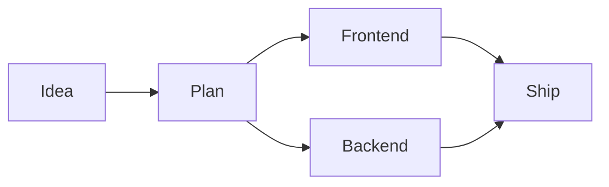

# vue-mermaid-steps

A Vue 3 component for progressively revealing Mermaid diagrams. Nodes and edges
in completed steps stay fully visible; future steps are dimmed.

Built on [vue-mermaid-string](https://www.npmjs.com/package/vue-mermaid-string).
Requires Vue 3.5 or later and an ESM-capable Vue application.

[Try the live playground](https://murznn.github.io/vue-mermaid-steps/).

## Installation

After the package is published:

```sh
npm install vue-mermaid-steps
```

Before publication, build and pack this project with `npm pack`, then install the
generated tarball in a consumer application.

## Usage

```vue
<script setup lang="ts">
import { ref } from 'vue'
import VueMermaidSteps from 'vue-mermaid-steps'

const steps = 3
const currentStep = ref(0)
const diagram = ref(`flowchart LR
    Start step1E@--> Plan:::step1
    Plan step2E@--> Build:::step2
    Build step3E@--> Ship:::step3
    classDef step1 fill:#f99
    classDef step2 fill:#9f9
    classDef step3 fill:#99f
`)
</script>

<template>
  <button @click="currentStep = Math.max(0, currentStep - 1)">Previous</button>
  <button @click="currentStep = Math.min(steps, currentStep + 1)">Next</button>
  <VueMermaidSteps
    :diagram="diagram"
    :steps="steps"
    :current-step="currentStep"
  />
</template>
```

Both default and named imports are available:

```ts
import { VueMermaidSteps } from 'vue-mermaid-steps'
```

The same component works in Slidev: import it in a slide's `<script setup>` and
bind `current-step` to reactive state (or Slidev's `$clicks`).

## Props

All props are reactive. `diagram` and `steps` are required; `currentStep`
`edgesPerStep`, and `inactiveOpacity` are optional.

| Prop | Type | Meaning |
| --- | --- | --- |
| `diagram` | `string` | Mermaid source code. |
| `steps` | `number` | Non-negative integer number of step classes to generate. |
| `currentStep` | `number` | Optional integer number of steps to reveal, normally from `0` to `steps`. Defaults to `0` (all steps dimmed). |
| `edgesPerStep` | `number` | Non-negative safe integer number of edge IDs to map per step, including the base ID. Defaults to `8`. |
| `inactiveOpacity` | `number` | Opacity of future steps, from `0` (transparent) to `1` (fully visible). Defaults to `0.2`. Invalid values raise a `RangeError`. |

### Step classes

- Assign nodes to `step1`, `step2`, etc. using `:::step1` or `class`.
- Name edges `step1E`, `step2E`, etc. using Mermaid's `id@-->` syntax.
  The component automatically maps these IDs to the corresponding edge class.
- Elements in steps up to `currentStep` have opacity `1`.
- Later steps use `inactiveOpacity` (default `0.2`); completed steps stay at `1`.
- At step `0`, all numbered steps are dimmed. At `steps`, all are visible.
- Elements without step classes are unaffected.
- `steps: 0` passes the diagram through unchanged.
- Values of `currentStep` below `0` dim every step; values above `steps` reveal
  every step. They do not generate additional step classes.

### Edge naming convention

By default, each step maps 8 unique edge IDs: the base `stepNE` plus `stepNEa`
through `stepNEg`, where `N` is the step number. For step 1 these are:

```text
step1E, step1Ea, step1Eb, step1Ec, step1Ed, step1Ee, step1Ef, step1Eg
```

Adjust dimming independently of the current step:

```vue
<VueMermaidSteps :diagram="diagram" :steps="3" :inactive-opacity="0.4" />
```

Mermaid edge IDs must be unique within the diagram. Use a different suffix for
each edge in the same step; all configured IDs are automatically assigned to the shared
`stepNE` class. Only use the IDs you need; unused mappings add no nodes or edges.
The IDs are case-sensitive, with an uppercase `E` and lowercase suffixes.

Pass `:edges-per-step="16"` to map the base ID plus `a` through `o`, or use a
larger count as needed. Suffixes continue `a` ... `z`, `aa`, `ab`, ...; for
example, `28` includes `stepNEaa`. The count includes the unsuffixed base ID.
Changing this prop regenerates the mappings. `0` disables automatic edge
mappings while retaining node and edge class opacity definitions. Invalid
counts (negative, fractional, or non-finite) raise a `RangeError`.

```vue
<VueMermaidSteps :diagram="diagram" :steps="3" :edges-per-step="16" />
```

For example, two branches can reveal together without manual `class` mappings:



The component appends edge `class` mappings and `classDef` opacity declarations
for every configured step. IDs beyond `edgesPerStep` are not automatically mapped.
Existing custom edge IDs and manual `class customId stepNE` mappings still work.

Existing colors and other class styles are preserved, but step opacity is controlled by
the component. Supply a complete, valid Mermaid diagram, ending outside any
subgraph, comment or directive. Classes beyond the configured `steps` are not
modified.

### Renderer options and events

Attributes and listeners are forwarded to `vue-mermaid-string`, including
`class`, `style`, `options`, `@rendered`, `@node-click`, and `@parse-error`.
For example:

```vue
<VueMermaidSteps
  :diagram="diagram"
  :steps="3"
  :current-step="currentStep"
  :options="{ theme: 'dark' }"
  @parse-error="handleParseError"
/>
```

Mermaid's default error display is retained. Handle `parse-error` for custom
error reporting. Only render diagram content from sources you trust; this
component does not add sanitization beyond the underlying renderer.

## Development

Run commands from this directory. Node.js 22.12+ and npm are required; no Slidev
installation or files from a parent repository are needed.

```sh
npm ci
npm run typecheck
npm test
npm run build
```

- `npm run test:watch` runs tests in watch mode.
- `npm run build` creates an ESM library and TypeScript declarations in `dist/`.
- Vue and `vue-mermaid-string` are externalized from the build.
- Tests stub the Mermaid renderer to verify source generation, prop reactivity,
  attribute forwarding, and events without coupling to SVG layout.
- Playground tests cover editing, step controls, validation, and error recovery.

## GitHub build

[The build workflow](./.github/workflows/build.yml) runs on pushes, pull requests,
and manual dispatch. It installs from the lockfile, checks types, runs tests,
builds, and uploads an npm tarball as an artifact. It does not publish to npm
and requires no registry credentials.

## Live playground and GitHub Pages

The [playground](./playground/App.vue) includes an editable Mermaid source,
step-count input, current-step and inactive-opacity sliders, previous/next and hide/show controls,
resettable example, and explicit validation/rendering errors. Source changes are
applied with **Apply diagram**; step changes update the preview immediately.

```sh
npm run dev
npm run build:playground
npm run preview
```

The production demo is written to `playground-dist/`, separately from the npm
library in `dist/`. Relative asset URLs support both project Pages URLs
(`https://OWNER.github.io/REPOSITORY/`) and custom domains. No repository name
needs to be hardcoded. The playground is excluded from the npm tarball.

To publish the standalone repository's demo:

1. In GitHub **Settings > Pages > Build and deployment**, select **GitHub Actions**
   as the source.
2. Push to the repository's default branch, or manually run the **Build** workflow
   on that branch.
3. Open the URL reported by the workflow's **github-pages** deployment.

The build job checks types, runs tests, and builds both the library and demo on
every push and pull request. Only default-branch pushes and manual runs deploy
the playground. The deploy job uses GitHub's built-in token and OIDC permissions;
no personal access token or npm credentials are needed.

When extracting this directory, copy its entire contents, including `.github`,
`.gitignore`, and `package-lock.json`, to the root of the new repository.
GitHub only discovers workflows in a repository's root `.github/workflows`;
the nested workflow is inactive while this project remains inside another
repository.

## Packaging and publication

```sh
npm pack --dry-run
npm pack
```

Packing automatically builds the library. Only `dist/`, this README, the license,
and package metadata are included. Install the resulting `.tgz` in a Vue application to test
the distributable before releasing it.

Before the first public release:

1. Confirm the npm package name is available, or choose a scoped name.
2. Update the version as appropriate.
3. Authenticate with npm and run `npm publish --access public` when ready.

## License

[MIT](./LICENSE), copyright 2026 Alexey Korepov.
